# Control Electoral · Ionic React + Capacitor + Supabase

Aplicación móvil para que una organización política registre y supervise el escrutinio por JRV (juntas receptoras del voto) en las dignidades de **Alcalde** y **Prefecto**.

- **Estudiante:** Dilan Artemio Obando Suárez
- **Equipo (línea base ADR):** Ariel Alexander Arias Toasa y Dilan Artemio Obando Suárez · Grupo 1
- **Asignatura:** Desarrollo de Aplicaciones Móviles · ESFOT
- **Video de deliberación:** https://youtu.be/acl_hGWJ8hk
- **Decisiones de arquitectura:** [`docs/adr`](docs/adr) · [Acta de consenso](docs/acta-consenso.md)

## Tecnologías (según los ADR)

| Decisión | Tecnología | ADR |
| --- | --- | --- |
| Framework | Ionic React 8 + TypeScript + React Router (`@ionic/react-router`) | [ADR-001](docs/adr/ADR-001-ionic-react.md) |
| Backend | Supabase: Auth, PostgreSQL, Storage, RLS, Edge Functions | [ADR-002](docs/adr/ADR-002-supabase.md) |
| Fotos | Supabase Storage, bucket privado `actas`, URL firmada | [ADR-003](docs/adr/ADR-003-supabase-storage.md) |
| Nativo | Capacitor 7: camera, geolocation, network, preferences, filesystem | [ADR-004](docs/adr/ADR-004-capacitor.md) |
| Estado | React Context API (`AuthContext`) | [ADR-005](docs/adr/ADR-005-react-context-api.md) |
| Base de datos | PostgreSQL (11 tablas, triggers, RLS) | [ADR-006](docs/adr/ADR-006-postgresql.md) |
| Nitidez de foto | Varianza del Laplaciano con Canvas, sin dependencias | [ADR-007](docs/adr/ADR-007-nitidez-foto-acta.md) |

## Requisitos previos

- Node.js 20 o superior y npm
- Android Studio (SDK de Android y JDK 21) para generar el APK
- Una cuenta de Supabase

## Instalación y ejecución

```bash
npm install
cp .env.example .env        # en Windows: copy .env.example .env
# completar VITE_SUPABASE_URL y VITE_SUPABASE_ANON_KEY
npm run dev                 # navegador: http://localhost:5173
```

### Configuración de Supabase (sin secretos en el repositorio)

1. Crear un proyecto en Supabase.
2. En **SQL Editor** ejecutar en orden: `supabase/01_schema.sql`, `02_seguridad.sql`, `03_storage.sql`, `04_seed.sql`.
3. Crear el coordinador provincial inicial (no hay autorregistro): **Authentication → Users → Add user** (contraseña `Ecuador2026`, *Auto Confirm User*) y ejecutar el bloque comentado al final de `04_seed.sql`.
4. **Edge Functions:** desplegar `supabase/functions/login` y `supabase/functions/crear-usuario` (desde el editor del panel o con `supabase functions deploy`), con **Verify JWT desactivado**; cada función valida por su cuenta. La clave `service_role` solo existe en el servidor de Supabase, nunca en la app.
5. **Authentication → Emails → Reset Password:** agregar `{{ .Token }}` a la plantilla para que el correo incluya el código de recuperación (plantilla lista en `supabase/templates/recovery.html`). En el plan gratuito, Supabase solo permite editar plantillas después de configurar un SMTP propio (Authentication → SMTP); sin SMTP, el correo de recuperación llega con un enlace en lugar del código.
6. Correo: el servidor de correo incluido en Supabase tiene un límite bajo de envíos. Si no envía a direcciones externas, la cuenta se crea igual y la app lo indica. Para producción se configura un SMTP propio en Authentication → SMTP.

El archivo `.env` está en `.gitignore`. Solo se usa la clave **pública** (anon/publishable).

**Alternativa con Supabase CLI** (lo usado en este proyecto): `npx supabase login`, `npx supabase link --project-ref <REF>`, `npx supabase db push` (aplica `supabase/migrations`), `npx supabase functions deploy login --no-verify-jwt` y `npx supabase functions deploy crear-usuario --no-verify-jwt`.

### Generar el APK Android

```bash
npx cap add android          # solo la primera vez
npm run android:permisos     # agrega permisos de cámara y ubicación al AndroidManifest
npm run android:sync         # build web + copia a Android
npx cap open android         # Android Studio → Build → Build APK(s)
```

El APK queda en `android/app/build/outputs/apk/debug/app-debug.apk`. **APK instalable:** carpeta [`apk/`](apk) del repositorio y sección *Releases* (v1.0).

El ícono de la app y el splash se generan desde `assets/` (logo y splash) y están en `android/app/src/main/res`.

## Arquitectura

```text
src/
  pages/        Presentación: una carpeta por rol (auth, veedor, recinto, provincial)
  components/   Piezas reutilizables: Encabezado, EstadoVista, CampoError, FormularioUsuario, RutaProtegida
  contexts/     Estado compartido: AuthContext (sesión, perfil, rol)                     [ADR-005]
  services/     Acceso a datos y hardware: Supabase, Storage, cámara, GPS, red          [ADR-002/003/004]
  utils/        Lógica de negocio pura: validaciones (cédula, totales), nitidez, errores [ADR-007]
  models/       Tipos TypeScript de las tablas                                           [ADR-006]
  config/       Cliente Supabase con clave pública                                       [ADR-002]
supabase/       Esquema, seguridad RLS, storage, datos iniciales y Edge Functions
```

**Regla:** las páginas nunca llaman a Supabase directamente; usan `services`. Las validaciones están en `utils` y se repiten en el backend (triggers y Edge Functions). La autorización real está en las **políticas RLS**; ocultar pantallas es solo experiencia de usuario.

### Flujo de seguridad

- **Login con cédula (R3):** la app envía cédula y contraseña a la Edge Function `login`, que busca el correo con la clave de servicio y devuelve la sesión. Así la app no expone correos ni claves administrativas.
- **Creación de cuentas (R2):** la Edge Function `crear-usuario` verifica el token y el rol de quien llama (provincial → coordinador de recinto; coordinador → veedor), valida la cédula, crea la cuenta con `Ecuador2026`, envía la invitación por correo y marca `debe_cambiar_password`.
- **Cambio obligatorio:** `RutaProtegida` envía al usuario a "Cambiar contraseña" mientras `debe_cambiar_password` sea verdadero.
- **RLS (R8):** `usuario_puede_acceder_jrv(jrv)` decide qué JRV ve cada rol. El veedor solo ve las asignadas; el coordinador, las de su recinto; el provincial, todas. La escritura de actas y fotos usa `usuario_puede_editar_jrv`.

## Modelo de datos

| Tabla | Contenido |
| --- | --- |
| `perfiles` | Cédula, nombres, apellidos, teléfono, correo, rol, `debe_cambiar_password`, `creado_por` |
| `provincias`, `cantones`, `parroquias` | División territorial (Pichincha / Quito) |
| `recintos` | Nombre, dirección, parroquia y cantidad de JRV; un trigger crea las JRV |
| `jrv` | Mesa: recinto y número |
| `organizaciones` | 5 organizaciones (siglas, lista) |
| `candidaturas` | 5 a alcaldía y 5 a prefectura |
| `asignaciones` | Coordinador ↔ recinto (uno por recinto) y veedor ↔ JRV (uno por JRV, reasignable) |
| `actas` | Por JRV y dignidad: total, nulos, blancos, ruta de foto, nitidez, latitud, longitud, precisión |
| `detalle_votos` | Votos por candidatura de cada acta |

Vistas: `v_mesas`, `v_avance_recintos`, `v_resultados`, `v_ubicaciones_actas` (con `security_invoker`, respetan RLS).
RPC: `guardar_acta` (guarda o corrige en una transacción) y `marcar_password_cambiada`.
Regla de negocio en base de datos: el *constraint trigger* `validar_totales_acta` exige **válidos + nulos + blancos = total de sufragantes** y que estén las 5 candidaturas de la dignidad.

## Funcionalidades por requisito

| Req. | Dónde |
| --- | --- |
| R1 Datos iniciales | `supabase/04_seed.sql` |
| R2 Jerarquía y cuentas | `FormularioUsuario.tsx`, `functions/crear-usuario`, `utils/validaciones.ts` (`validarCedula`) |
| R3 Acceso | `pages/auth/*`, `functions/login`, `AuthContext.tsx`, `RutaProtegida.tsx` |
| R4 Coordinador provincial | `pages/provincial/Recintos.tsx`, `RecintoDetalle.tsx`, `Dashboard.tsx` |
| R5 Coordinador de recinto | `pages/recinto/MesasRecinto.tsx`, `VeedoresRecinto.tsx` |
| R6 Veedor | `pages/veedor/MisMesas.tsx`, `ActaFormulario.tsx`, `validarTotalesActa` |
| R7 Cámara y GPS | `services/camaraService.ts`, `ubicacionService.ts`, `utils/nitidez.ts` |
| R8 Seguridad | `supabase/02_seguridad.sql`, `03_storage.sql`, `05_pruebas_rls.sql` |
| R9 Arquitectura y UX | Capas de `src/`, `EstadoVista`, toasts, errores por campo |
| R10 Offline (opcional) | No implementado. Solo se detecta la falta de red (`@capacitor/network`) y se avisa antes de guardar |

## Pruebas

| # | Prueba | Resultado esperado |
| --- | --- | --- |
| 1 | Login con cédula de dígito verificador incorrecto | Error bajo el campo, no se envía |
| 2 | Primer login con `Ecuador2026` | Redirige a "Cambiar contraseña"; no acepta repetir `Ecuador2026` |
| 3 | Recuperar contraseña con el correo registrado | Llega un código; con él se fija una nueva clave |
| 4 | Provincial crea recinto con 3 JRV | Aparecen 3 JRV en el detalle |
| 5 | Provincial crea y asigna coordinador | El recinto muestra el coordinador |
| 6 | Coordinador crea veedor y lo asigna a una JRV; luego lo reasigna | El veedor anterior deja de ver la mesa |
| 7 | Veedor ingresa totales que no cuadran | Mensaje de diferencia y botón deshabilitado |
| 8 | Veedor toma foto movida | "Foto borrosa (nitidez X, mínimo 60)" |
| 9 | Veedor niega permiso de cámara o de GPS | Mensaje explicando cómo habilitarlo |
| 10 | Veedor registra acta completa | Acta guardada, foto en `actas/ID_JRV/ID_ACTA.jpg`, coordenadas visibles en el dashboard |
| 11 | Coordinador corrige un acta | Se guarda; `actualizado_por` registra quién corrigió |
| 12 | Veedor A intenta leer o guardar una JRV del veedor B (`05_pruebas_rls.sql`) | 0 filas / `NO_AUTORIZADO` |
| 13 | Insertar un acta descuadrada directamente en SQL | El trigger la rechaza con `ACTA_INCONSISTENTE` |
| 14 | Modo avión al guardar | "Sin conexión…", los datos permanecen en pantalla |

Comandos: `npm run typecheck` y `npm run build`.

## Evidencias de ejecución (APK en un teléfono Android)

Capturas tomadas con el APK de [`apk/app-debug.apk`](apk/app-debug.apk) conectado al proyecto Supabase. La cédula real se ocultó en las imágenes.

| # | Captura | Qué muestra | Requisito |
| --- | --- | --- | --- |
| 1 | 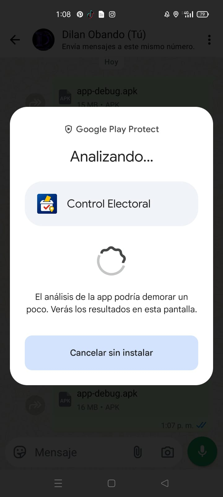 | Instalación del APK desde el teléfono; Google Play Protect analiza la app "Control Electoral". | Entrega / APK |
| 2 | 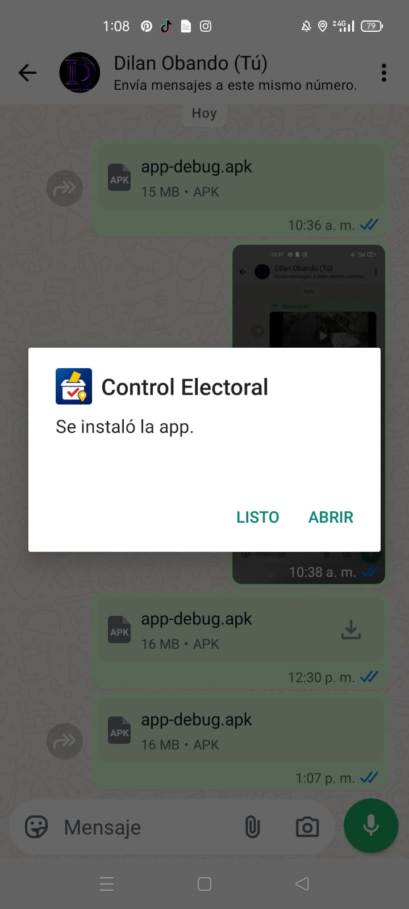 | La app queda instalada con su ícono propio. | Entrega / APK |
| 3 | 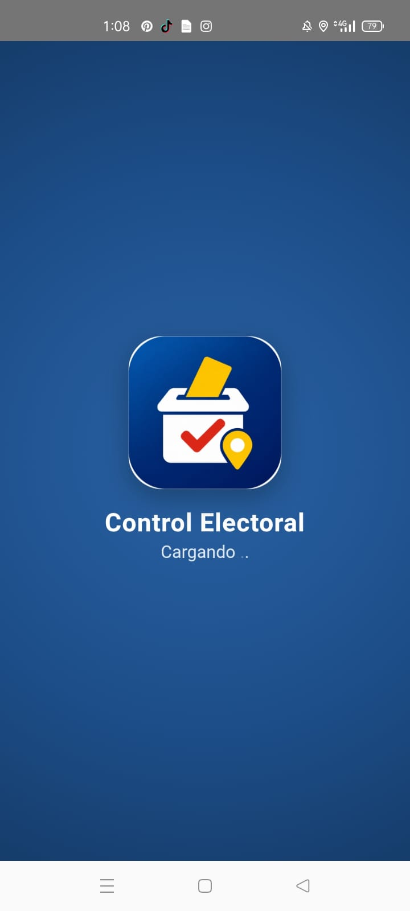 | Pantalla de carga animada mientras se recupera la sesión guardada (estado explícito de carga). | R9 |
| 4 | 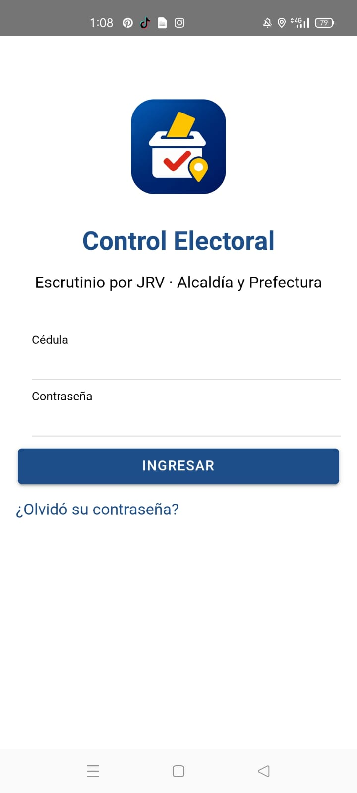 | Inicio de sesión con la **cédula** como identificador visible y enlace "¿Olvidó su contraseña?". | R3 |
| 5 | 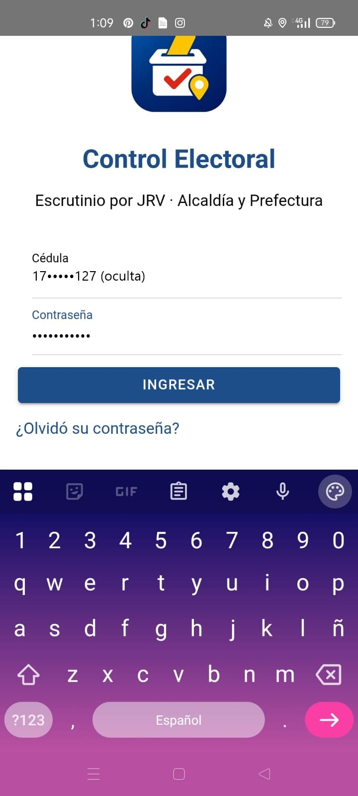 | El campo cédula solo admite 10 dígitos; la contraseña se oculta. | R2, R3 |
| 6 | 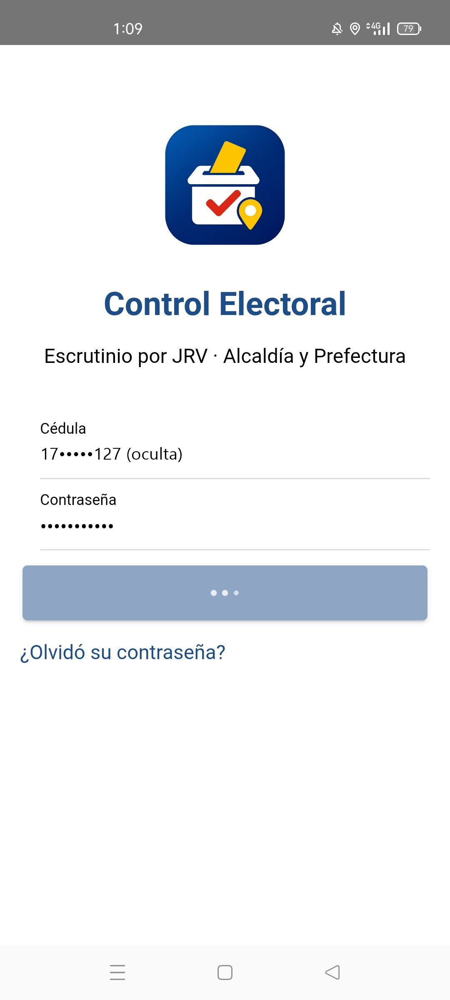 | Botón en estado de carga mientras la Edge Function `login` valida las credenciales en el servidor. | R3, R9 |
| 7 | 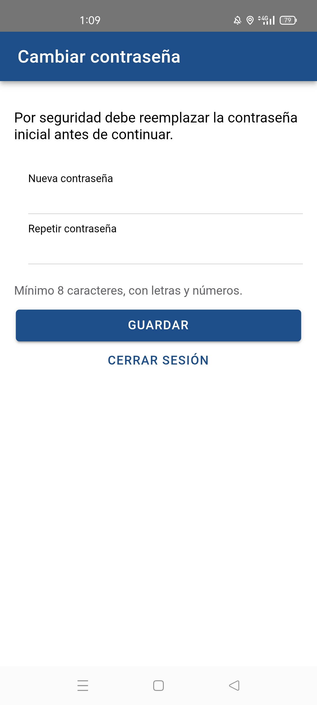 | Primer acceso con `Ecuador2026`: la app obliga a cambiar la contraseña antes de continuar. | R3 |
| 8 | 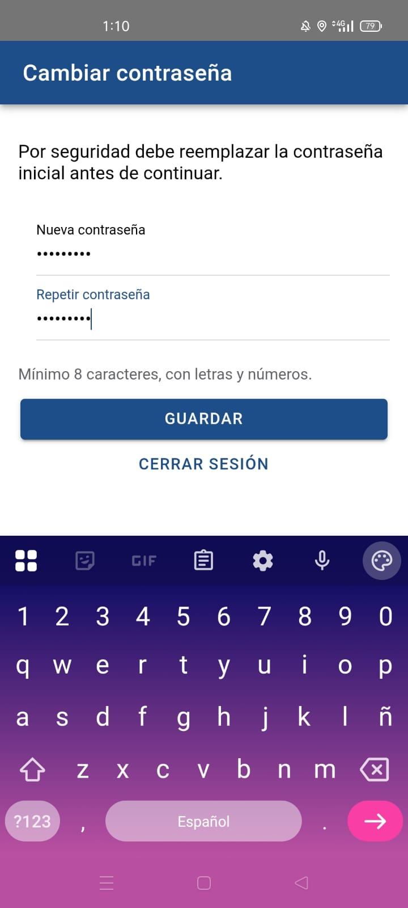 | Ingreso de la nueva contraseña (mínimo 8 caracteres, letras y números, distinta de la inicial). | R3 |
| 9 | 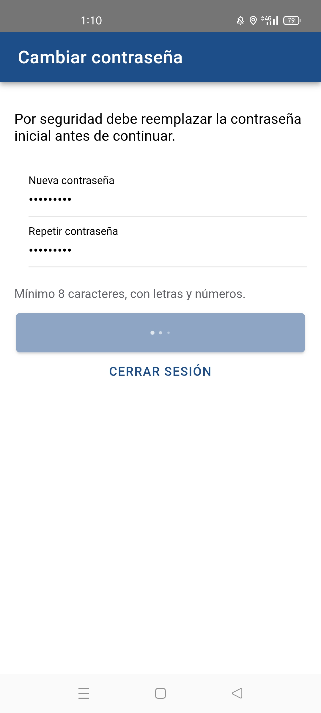 | Guardando la nueva contraseña; se marca `debe_cambiar_password = false`. | R3, R9 |
| 10 | 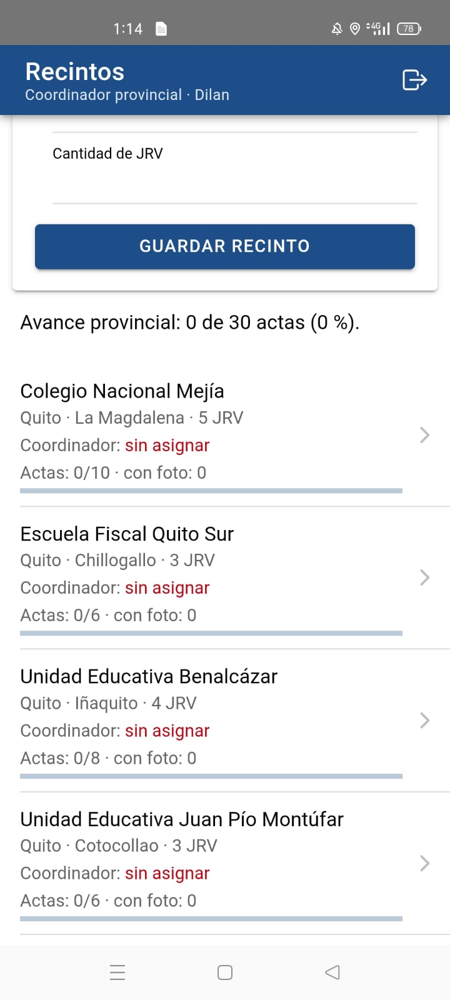 | Coordinador provincial: recintos precargados de Quito (cantón, parroquia, nombre y JRV), avance provincial de actas y coordinador de cada recinto. | R1, R4 |
| 11 | 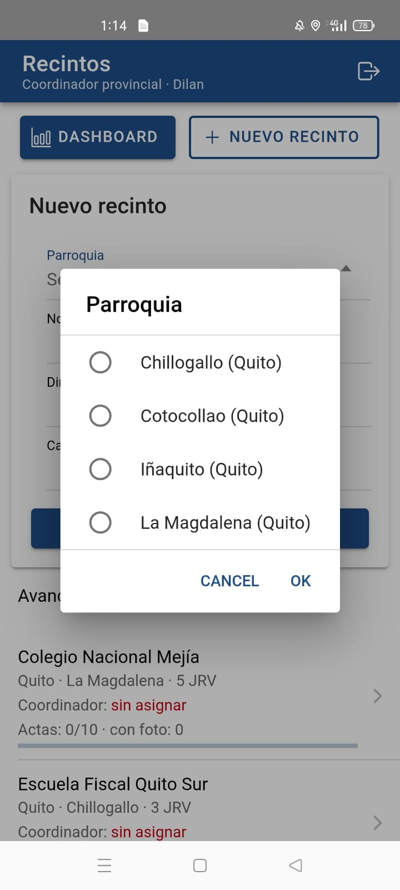 | Crear recinto: selección de parroquia, nombre, dirección y cantidad de JRV. Las JRV se crean automáticamente. | R4 |
| 12 | 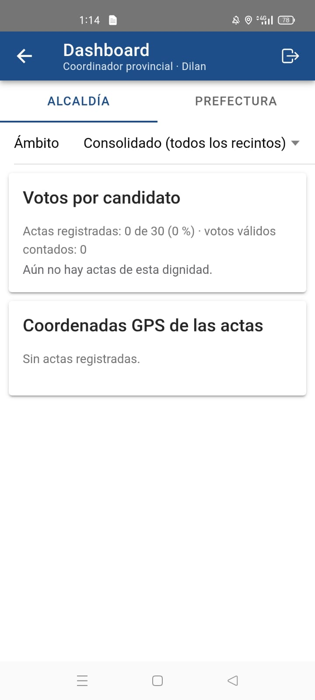 | Dashboard: votos por candidato (Alcaldía / Prefectura), ámbito consolidado o por recinto, y coordenadas GPS de las actas. | R4 |
| 13 | 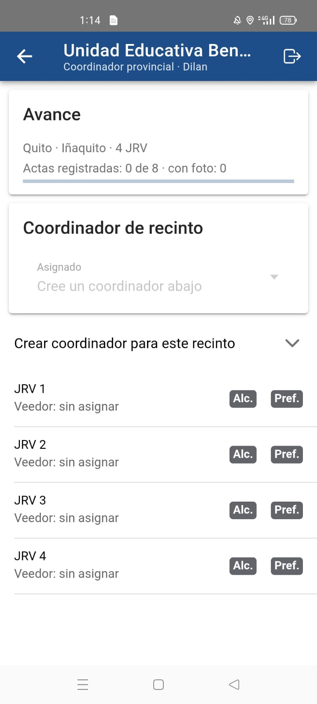 | Detalle de recinto: avance, asignación del coordinador de recinto y JRV 1–4 con estado de actas de Alcalde y Prefecto. | R4, R5 |
| 14 | 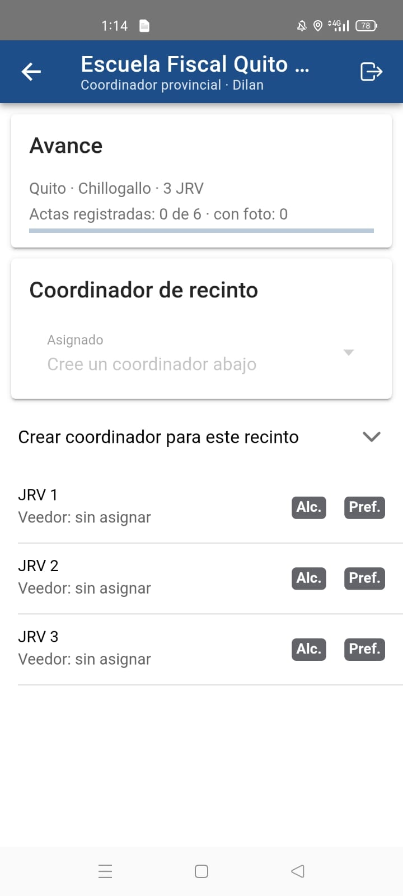 | Otro recinto (3 JRV): cada JRV muestra su veedor y el estado de sus actas. | R1, R4 |
| 15 | 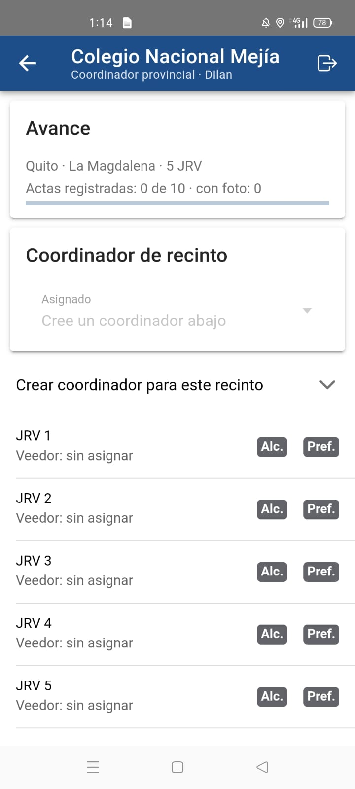 | Recinto con 5 JRV y opción "Crear coordinador para este recinto" (no hay autorregistro). | R2, R4 |

## Credenciales de demostración (no sensibles)

Todas las cuentas nuevas se crean con la contraseña inicial **`Ecuador2026`** y deben cambiarla en el primer acceso. Las cédulas de demostración se completan después de crear los usuarios:

| Rol | Cédula | Contraseña tras el primer acceso |
| --- | --- | --- |
| Coordinador provincial | se entrega en la defensa (cuenta real) | se entrega en la defensa |
| Coordinador de recinto | 1723456784 (cédula de prueba) | Ecuador2026 hasta el primer acceso |
| Veedor | 1709876542 (cédula de prueba) | Ecuador2026 hasta el primer acceso |

## Uso de IA

Ver [`docs/anexo-ia.md`](docs/anexo-ia.md).
